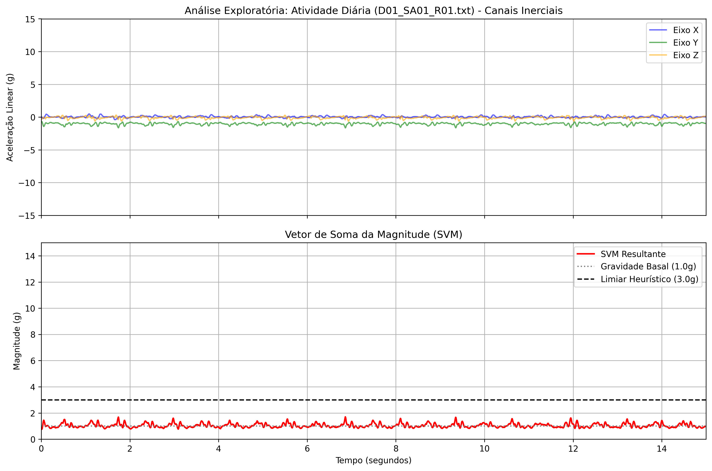
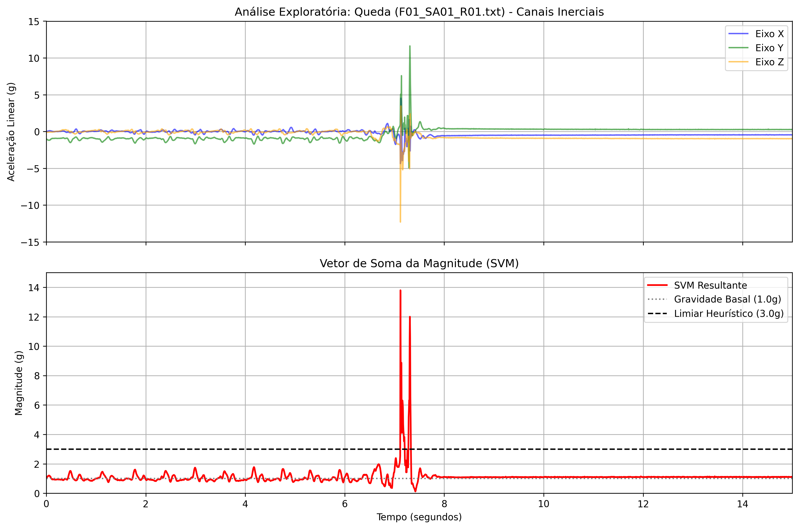
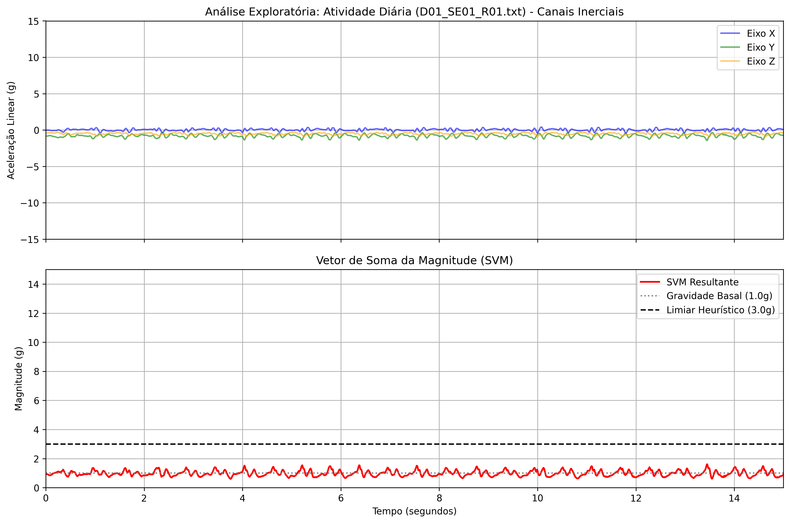

# UNIVERSIDADE ESTADUAL DE FEIRA DE SANTANA (UEFS)
**Pró-Reitoria de Pesquisa e Pós-Graduação (PPPG)**  
**Programa Institucional de Bolsas de Iniciação em Desenvolvimento Tecnológico e Inovação (PIBITI/CNPq)**  
**Edital PPPG-IT/UEFS Nº 02/2026**

**Projeto de Pesquisa:** Sistemas Embarcados, Internet das Coisas (IoT) e Inteligência Artificial Aplicada à Saúde Assistiva  
**Plano de Trabalho:** Cinto Vestível com IoT para Monitoramento de Idosos  
**Orientador:** Prof. Dr. Germano Pinto Guedes (`germano@uefs.br`)  
**Bolsista:** Felipe Amorim do Carmo Silva (`felipedocarmo05@gmail.com`)  

---

# RELATÓRIO TÉCNICO PARCIAL — MÊS 04
**Período de Referência:** Mês 04 do Cronograma de Execução  
**Etapa:** Aquisição, Estruturação e Análise Exploratória do Dataset Público SisFall em Ambiente Python  
**Artefatos Associados:** [`baixar_sisfall.py`](baixar_sisfall.py), [`analise_sisfall.py`](analise_sisfall.py), [`exploratoria_D01_SA01_R01.png`](exploratoria_D01_SA01_R01.png), [`exploratoria_F01_SA01_R01.png`](exploratoria_F01_SA01_R01.png), [`exploratoria_D01_SE01_R01.png`](exploratoria_D01_SE01_R01.png)

---

## RESUMO

Este relatório apresenta o desenvolvimento e os resultados da etapa referente ao quarto mês de execução do projeto, dedicada à importação automatizada, tratamento inicial e análise exploratória da base de dados pública **SisFall** em ambiente Python. Os dados brutos do acelerômetro triaxial ADXL345 — originalmente expressos em unidades inteiras de conversão analógico-digital (ADC de 13 bits) — foram matematicamente convertidos para aceleração física em múltiplos da gravidade terrestre ($g$). Ademais, implementou-se um carregador híbrido tolerante a formato (capaz de processar tanto os arquivos `.txt` brutos originais quanto variantes `.csv` pré-processadas) e realizou-se o estudo comparativo de três cenários biomecânicos fundamentais: caminhada de adulto jovem (`D01_SA01`), queda frontal por escorregão (`F01_SA01`) e caminhada de voluntário idoso (`D01_SE01`).

**Palavras-chave:** Análise Exploratória de Dados. SisFall. Acelerometria Triaxial. Biomecânica da Queda. Python.

---

## 1 ESTRUTURA DA BASE DE DADOS SISFALL E RELEVÂNCIA METODOLÓGICA

A base de dados **SisFall** (SUCERQUIA; LÓPEZ; VARGAS-BONILLA, 2017) foi obtida programaticamente por meio da biblioteca `kagglehub` ([`baixar_sisfall.py`](baixar_sisfall.py)) e organizada localmente em subdiretórios correspondentes aos 38 voluntários participantes (`SA01` a `SA23` para adultos jovens de 19 a 30 anos; `SE01` a `SE15` para idosos de 60 a 75 anos), totalizando **4.505 arquivos** de séries temporais.

### 1.1 A Limitação Ética e a Prevenção de Falsos Positivos

Por restrições éticas e de segurança médica, os voluntários idosos (`SE`) não foram submetidos a simulações de queda em colchão, executando exclusivamente Atividades de Vida Diária (arquivos iniciados com o prefixo `D`, como caminhar, sentar-se e subir escadas), com a única exceção do participante `SE06`, especialista em judô (SUCERQUIA; LÓPEZ; VARGAS-BONILLA, 2017). Os voluntários jovens (`SA`), por sua vez, realizaram tanto as 19 atividades cotidianas (`D01` a `D19`) quanto as 15 categorias de quedas (`F01` a `F15`).

A fusão dessas duas coortes demográficas cumpre um papel determinante no treinamento do futuro classificador embarcado: caso o modelo fosse treinado somente com o grupo `SE`, jamais reconheceria a assinatura matemática de uma queda; inversamente, caso fosse treinado apenas com o grupo `SA`, sofreria perda de especificidade e sensibilidade ao monitorar um usuário idoso real, cujo padrão de marcha mais arrastado ou transição postural mais brusca ao sentar-se poderia ser confundido com um evento de queda.

### 1.2 Codificação dos Sensores, Taxa de Amostragem e Conversão ADC para Gravidade ($g$)

Cada arquivo bruto (`.txt`) do SisFall foi amostrado a uma taxa constante de $f_s = 200\text{ Hz}$ ($1\text{ s} = 200\text{ amostras}$) e contém 9 colunas separadas por vírgula, terminadas por ponto e vírgula (`;`):
* **Colunas 1, 2 e 3 (`ADXL_X`, `ADXL_Y`, `ADXL_Z`):** Acelerômetro triaxial **ADXL345**, configurado com resolução de $\text{Res} = 13\text{ bits}$ e fundo de escala de $\text{Range} = \pm 16\text{ g}$;
* **Colunas 4, 5 e 6 (`ITG_X`, `ITG_Y`, `ITG_Z`):** Giroscópio triaxial **ITG3200** ($\pm 2000^\circ/\text{s}$, 16 bits);
* **Colunas 7, 8 e 9 (`MMA_X`, `MMA_Y`, `MMA_Z`):** Acelerômetro secundário **MMA8451Q** ($\pm 8\text{ g}$, 14 bits).

Conforme especificado na documentação técnica oficial do SisFall, a conversão do valor digital bruto em bits ($\text{AD}$) do acelerômetro principal ADXL345 para unidades de aceleração da gravidade ($g$) obedece à equação:

$$a_{[g]} = \left( \frac{2 \times \text{Range}}{2^{\text{Resolution}}} \right) \times \text{AD} = \left( \frac{2 \times 16}{2^{13}} \right) \times \text{AD} = \frac{32}{8192} \times \text{AD} = \frac{\text{AD}}{256,0}$$

Portanto, cada incremento de $256\text{ LSB}$ (*Least Significant Bits*) equivale exatamente a $1,0\text{ g}$ ($9,80665\text{ m/s}^2$).

---

## 2 ENGENHARIA DE SOFTWARE: LEITURA HÍBRIDA (`.TXT` E `.CSV`)

Durante a manipulação da base de dados, verificou-se que repositórios secundários do SisFall disponibilizam versões convertidas em formato `.csv` contendo cabeçalho textual (`ADXL345_Acc_X`, `ADXL345_Acc_Y`, `ADXL345_Acc_Z`, ..., `FallCheck`) cujas amostras já se encontram pré-divididas por $256,0$. Caso um script projetado estritamente para `.txt` tentasse abrir um ambiente contendo arquivos `.csv`, ocorreria falha de execução (`FileNotFoundError`) ou dupla divisão por $256,0$.

Para assegurar robustez e reprodutibilidade ao projeto, implementou-se no script [`analise_sisfall.py`](analise_sisfall.py) a função `carregar_arquivo_sisfall()`, que inspeciona automaticamente a extensão e a estrutura das colunas do arquivo, aplicando a conversão $\text{AD}/256,0$ exclusivamente sobre matrizes brutas em bits.

### Listagem 1 — Script de Análise Exploratória e Plotagem Inercial (`analise_sisfall.py`)

```python
import os
import pandas as pd
import numpy as np
import matplotlib.pyplot as plt

def carregar_arquivo_sisfall(caminho_arquivo):
    # Alterna automaticamente entre .txt e .csv caso um deles não exista no caminho informado
    if not os.path.exists(caminho_arquivo):
        base, ext = os.path.splitext(caminho_arquivo)
        alternativo = base + ('.csv' if ext.lower() == '.txt' else '.txt')
        if os.path.exists(alternativo):
            caminho_arquivo = alternativo
        else:
            raise FileNotFoundError(f"Arquivo não encontrado (.txt ou .csv): {caminho_arquivo}")

    nomes_colunas = ['ADXL_X', 'ADXL_Y', 'ADXL_Z', 'ITG_X', 'ITG_Y', 'ITG_Z', 'MMA_X', 'MMA_Y', 'MMA_Z']

    if caminho_arquivo.lower().endswith('.csv'):
        df_raw = pd.read_csv(caminho_arquivo)
        if 'ADXL345_Acc_X' in df_raw.columns:
            df = pd.DataFrame()
            df['Eixo_X_g'] = pd.to_numeric(df_raw['ADXL345_Acc_X'], errors='coerce')
            df['Eixo_Y_g'] = pd.to_numeric(df_raw['ADXL345_Acc_Y'], errors='coerce')
            df['Eixo_Z_g'] = pd.to_numeric(df_raw['ADXL345_Acc_Z'], errors='coerce')
            return df.dropna(), caminho_arquivo
        else:
            df = pd.read_csv(caminho_arquivo, sep=',', names=nomes_colunas, usecols=range(9))
    else:
        df = pd.read_csv(caminho_arquivo, sep=',', names=nomes_colunas, usecols=range(9), engine='c')

    for col in ['ADXL_X', 'ADXL_Y', 'ADXL_Z']:
        df[col] = pd.to_numeric(df[col], errors='coerce')
    df = df.dropna(subset=['ADXL_X', 'ADXL_Y', 'ADXL_Z'])

    df['Eixo_X_g'] = df['ADXL_X'] / 256.0
    df['Eixo_Y_g'] = df['ADXL_Y'] / 256.0
    df['Eixo_Z_g'] = df['ADXL_Z'] / 256.0
    return df, caminho_arquivo
```

---

## 3 ANÁLISE GRÁFICA DOS CENÁRIOS BIOMECÂNICOS

Padronizou-se uma janela temporal de visualização de $0\text{ s}$ a $15\text{ s}$ no eixo das abscissas e limites de aceleração de $-15\text{ g}$ a $+15\text{ g}$ (painel superior triaxial) e de $0\text{ g}$ a $15\text{ g}$ (painel inferior do vetor resultante $\text{SVM} = \sqrt{X^2 + Y^2 + Z^2}$), demarcando-se a gravidade basal ($1,0\text{ g}$) e o limiar heurístico clássico ($3,0\text{ g}$).

### 3.1 Cenário A: Caminhada Lenta — Adulto Jovem (`D01_SA01_R01`)

Na Figura 1, observa-se uma oscilação periódica regular nos canais triaxiais, com predominância da componente vertical (Eixo Y) em torno de $-1,0\text{ g}$ devido à orientação do sensor na cintura. O vetor resultante $\text{SVM}$ flutua ciclicamente entre $0,8\text{ g}$ e $1,5\text{ g}$ a cada toque do calcanhar no solo, permanecendo distante do limiar de $3,0\text{ g}$.

  
**Figura 1 —** Canais inerciais triaxiais e Vetor de Soma da Magnitude (SVM) para caminhada lenta de adulto jovem (`D01_SA01_R01`). **Fonte:** Elaborado pelo autor (2026).

### 3.2 Cenário B: Queda Frontal por Escorregão — Adulto Jovem (`F01_SA01_R01`)

A Figura 2 expõe a anatomia física completa de um evento de queda por volta do instante $t = 7,0\text{ s}$, dividida em três estágios sequenciais:
1. **Fase de Imponderabilidade (Queda Livre):** Segundos antes da colisão, a perda de sustentação faz com que a resultante $\text{SVM}$ caia momentaneamente abaixo da linha de gravidade basal ($< 1,0\text{ g}$);
2. **Fase de Impacto Agudo:** No instante do choque do tronco contra o solo, o Eixo Z sofre uma deflexão abrupta até cerca de $-12,0\text{ g}$, elevando o pico do vetor $\text{SVM}$ para aproximadamente $14,0\text{ g}$ (rompendo drasticamente o limiar de $3,0\text{ g}$);
3. **Fase de Repouso Pós-Queda:** Imediatamente após o amortecimento da colisão ($t > 8,5\text{ s}$), as oscilações cessam, os eixos Y e Z invertem seus patamares estáticos (evidenciando a rotação de $90^\circ$ do tronco para a posição horizontal) e o $\text{SVM}$ estabiliza-se em $1,0\text{ g}$.

  
**Figura 2 —** Anatomia inercial de uma queda frontal (`F01_SA01_R01`), destacando queda livre, pico de impacto ($\approx 14\text{ g}$) e imobilidade pós-impacto. **Fonte:** Elaborado pelo autor (2026).

### 3.3 Cenário C: Caminhada Lenta — Voluntário Idoso (`D01_SE01_R01`)

Na Figura 3, referente a um voluntário idoso de 71 anos (`SE01`), o envelope macroscópico do $\text{SVM}$ mantém-se na faixa segura entre $0,8\text{ g}$ e $1,6\text{ g}$. Todavia, nota-se uma densidade maior de micro-oscilações de alta frequência ("serrilhado" na curva vermelha), decorrente da transmissão de vibrações de impacto (*heel strike*) e menor amortecimento articular, demonstrando visualmente a necessidade da filtragem digital passa-baixa a ser executada no Mês 05.

  
**Figura 3 —** Sinal inercial de caminhada de voluntário idoso (`D01_SE01_R01`), evidenciando ruído de alta frequência sobreposto à marcha. **Fonte:** Elaborado pelo autor (2026).

---

## 4 CONCLUSÃO DA ETAPA

A análise exploratória conduzida no Mês 04 comprovou que uma queda real distingue-se de atividades normais não apenas pela amplitude isolada do pico, mas pelo encadeamento morfológico entre queda livre, impacto, inversão de eixos gravitacionais e repouso subsequente. Além disso, a presença de ruído mecânico de alta frequência nos registros brutos fundamentou diretamente a etapa seguinte de Processamento Digital de Sinais (Mês 05).

---

## REFERÊNCIAS

BOURKE, A. K.; O'BRIEN, J. V.; LYONS, G. M. Evaluation of a threshold-based tri-axial accelerometer fall detection algorithm. **Gait & Posture**, v. 26, n. 2, p. 194-199, 2007.

SUCERQUIA, A.; LÓPEZ, J. D.; VARGAS-BONILLA, J. F. SisFall: A Fall and Movement Dataset. **Sensors**, v. 17, n. 1, p. 198, 2017.
