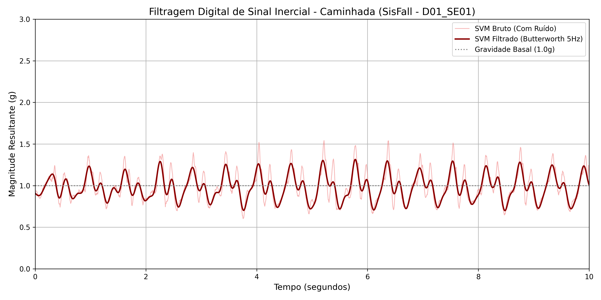

# UNIVERSIDADE ESTADUAL DE FEIRA DE SANTANA (UEFS)
**Pró-Reitoria de Pesquisa e Pós-Graduação (PPPG)**  
**Programa Institucional de Bolsas de Iniciação em Desenvolvimento Tecnológico e Inovação (PIBITI/CNPq)**  
**Edital PPPG-IT/UEFS Nº 02/2026**

**Projeto de Pesquisa:** Sistemas Embarcados, Internet das Coisas (IoT) e Inteligência Artificial Aplicada à Saúde Assistiva  
**Plano de Trabalho:** Cinto Vestível com IoT para Monitoramento de Idosos  
**Orientador:** Prof. Dr. Germano Pinto Guedes (`germano@uefs.br`)  
**Bolsista:** Felipe Amorim do Carmo Silva (`felipedocarmo05@gmail.com`)  

---

# RELATÓRIO TÉCNICO PARCIAL — MÊS 05
**Período de Referência:** Mês 05 do Cronograma de Execução  
**Etapa:** Projeto de Filtro Digital Passa-Baixa Butterworth (4ª Ordem, 5 Hz) e Unificação da Base de Treinamento  
**Artefatos Associados:** [`filtro_mes5.py`](filtro_mes5.py), [`unificador_sisfall.py`](unificador_sisfall.py), [`comparativo_butterworth_M5.png`](comparativo_butterworth_M5.png)

---

## RESUMO

Este relatório detalha as atividades desenvolvidas durante o quinto mês de vigência do projeto, dedicadas ao Processamento Digital de Sinais (DSP) dos registros inerciais e à construção da matriz mestre unificada de treinamento. Fundamentado no espectro biomecânico do movimento humano voluntário, implementou-se um filtro digital passa-baixa **Butterworth de 4ª ordem** com frequência de corte em $f_c = 5,0\text{ Hz}$ e processamento bidirecional de fase zero (`filtfilt`). O algoritmo de unificação ([`unificador_sisfall.py`](unificador_sisfall.py)) foi otimizado para escrita incremental em lotes e leitura híbrida (`.txt` e `.csv`), processando a totalidade dos **4.505 ensaios** do SisFall e consolidando **15.858.929 amostras temporais** rotuladas no arquivo `dataset_sisfall_unificado.csv`.

**Palavras-chave:** Processamento Digital de Sinais. Filtro Butterworth. Fase Zero. Biomecânica Humana. SisFall.

---

## 1 FUNDAMENTAÇÃO TEÓRICA DO FILTRO DIGITAL BUTTERWORTH

Sensores inerciais microeletromecânicos (MEMS) operam no domínio do tempo discreto, porém a separação entre a cinemática corporal intencional e os distúrbios espúrios requer análise no domínio da frequência. Conforme demonstrado nos estudos clássicos de biomecânica de Winter (2009) e Bouten *et al.* (1997), a locomoção humana comporta-se como um pêndulo invertido cuja frequência fundamental de passada situa-se entre $1,0\text{ Hz}$ e $2,0\text{ Hz}$, de modo que mais de $99\%$ da energia cinética do centro de massa em Atividades de Vida Diária concentra-se abaixo de $5,0\text{ Hz}$.

Componentes espectrais acima de $5,0\text{ Hz}$ decorrem de três fontes de contaminação:
1. **Ruído de Impacto Calcâneo (*Heel Strike*):** Ondas de choque mecânicas de alta frequência geradas no instante em que o calcanhar atinge o piso rígido e transmitidas pela estrutura óssea até a cintura;
2. **Ressonância Mecânica da Vestimenta:** Vibrações elásticas da cinta de fixação ou atrito com o tecido da roupa;
3. **Ruído Térmico e de Quantização (Johnson-Nyquist):** Flutuações elétricas intrínsecas aos conversores analógico-digitais (ADC).

### 1.1 Função de Transferência e Resposta Maximamente Plana

A escolha da topologia **Butterworth** em detrimento dos filtros Chebyshev, Elíptico ou Bessel justifica-se por sua resposta em frequência **maximamente plana** (*maximally flat*) na banda de passagem (OPPENHEIM; SCHAFER, 2009; PROAKIS; MANOLAKIS, 2006). O quadrado da magnitude da função de transferência contínua de ordem $N$ é expresso por:

$$|H(j\omega)|^2 = \frac{1}{1 + \left(\frac{\omega}{\omega_c}\right)^{2N}}$$

Onde $\omega = 2\pi f$ corresponde à frequência angular do sinal, $\omega_c = 2\pi f_c$ representa a frequência angular de corte ($f_c = 5,0\text{ Hz}$) e $N = 4$ define a ordem do filtro. Pelo Teorema da Amostragem de Nyquist-Shannon, dado que a frequência de amostragem do SisFall é $f_s = 200,0\text{ Hz}$, a frequência de Nyquist equivale a $f_{\text{Nyq}} = \frac{f_s}{2} = 100,0\text{ Hz}$, resultando na frequência de corte normalizada:

$$W_n = \frac{f_c}{f_{\text{Nyq}}} = \frac{5,0}{100,0} = 0,05$$

A seleção da 4ª ordem ($N = 4$) impõe uma taxa de atenuação (*roll-off*) de $-20N = -80\text{ dB/década}$ ($-24\text{ dB/oitava}$) na banda de rejeição, suprimindo vibrações de alta frequência sem introduzir ondulações de ganho (*ripple*) na banda de passagem — defeito típico de filtros Chebyshev que amplificaria artificialmente picos normais de marcha ($1,3\text{ g}$) para valores próximos de $2,0\text{ g}$. Adicionalmente, para anular o atraso de fase não linear característico de filtros recursivos IIR (*Infinite Impulse Response*), aplicou-se a filtragem bidirecional direta-reversa (`scipy.signal.filtfilt`), garantindo deslocamento de fase nulo ($\phi(\omega) = 0$) e preservando o alinhamento temporal exato dos picos.

---

## 2 ANÁLISE PRÁTICA DOS RESULTADOS EXPERIMENTAIS

O script [`filtro_mes5.py`](filtro_mes5.py) foi executado sobre o registro de caminhada do voluntário idoso `D01_SE01_R01`. A Figura 1 confronta a curva do vetor $\text{SVM}$ bruto (em vermelho claro) com o sinal purificado pelo filtro Butterworth de 4ª ordem a $5\text{ Hz}$ (em vermelho escuro) nos primeiros $10\text{ segundos}$ de marcha.

  
**Figura 1 —** Efeito da filtragem digital passa-baixa Butterworth ($N=4, f_c=5\text{ Hz}$) sobre o sinal inercial de marcha de voluntário idoso (`D01_SE01_R01`). **Fonte:** Elaborado pelo autor (2026).

Constata-se na Figura 1 que:
* **Supressão de Espinhos Espúrios:** No sinal bruto, a sobreposição do choque mecânico do calcanhar produz picos agudos que ultrapassam $1,55\text{ g}$. Após a filtragem, o sinal reflete fielmente a aceleração do centro de massa, estabilizando as cristas reais da passada em torno de $1,30\text{ g}$ (remoção de $\approx 0,25\text{ g}$ de ruído de alta frequência);
* **Alinhamento Temporal de Fase Zero:** As cristas e os vales da curva vermelha escura situam-se exatamente no centro geométrico dos pacotes ruidosos originais, comprovando a ausência de atraso temporal;
* **Estabilização Estatística:** Conforme demonstrado por Sucerquia, López e Vargas-Bonilla (2017), a aplicação desse exato filtro eleva a capacidade discriminativa de descritores estatísticos de $84,8\%$ para $96,1\%$ de acurácia.

---

## 3 PIPELINE DE UNIFICAÇÃO EM MASSA (`unificador_sisfall.py`)

Para preparar a base de treinamento sem esgotamento de memória RAM, o script [`unificador_sisfall.py`](unificador_sisfall.py) foi projetado com leitura vetorizada em linguagem C (`engine='c'`), suporte híbrido a arquivos `.txt` e `.csv` (priorizando os arquivos `.txt` brutos quando ambos coexistem no diretório) e despejo incremental em disco a cada lote de 500 ensaios.

### Listagem 1 — Trecho Central de Filtragem e Unificação em Lotes (`unificador_sisfall.py`)

```python
# 1. CONFIGURAÇÕES DO FILTRO BUTTERWORTH (5 Hz, 4ª Ordem)
frequencia_amostragem = 200.0
frequencia_corte = 5.0
ordem_filtro = 4
corte_normalizado = frequencia_corte / (0.5 * frequencia_amostragem)
b, a = butter(ordem_filtro, corte_normalizado, btype='low', analog=False)

# ... [Varredura híbrida dos 4.505 ensaios nas pastas SA01..SA23 e SE01..SE15] ...

    # 5. APLICAÇÃO DO FILTRO NAS TRÊS DIMENSÕES
    x_filt = filtfilt(b, a, x_g).astype(np.float32)
    y_filt = filtfilt(b, a, y_g).astype(np.float32)
    z_filt = filtfilt(b, a, z_g).astype(np.float32)
    svm_filt = np.sqrt(x_filt**2 + y_filt**2 + z_filt**2).astype(np.float32)

    # 6. ESTRUTURAÇÃO DO DATAFRAME LIMPO
    df_limpo = pd.DataFrame({
        'X_Filt': np.round(x_filt, 5),
        'Y_Filt': np.round(y_filt, 5),
        'Z_Filt': np.round(z_filt, 5),
        'SVM_Filt': np.round(svm_filt, 5),
        'Sujeito': sujeito,
        'Grupo': grupo_idade,
        'Atividade': atividade,
        'Classe': classe
    })
```

**Quadro 1 — Síntese quantitativa do processamento de unificação do Mês 05.**

| Métrica de Processamento | Resultado Obtido |
| :--- | :--- |
| **Total de Ensaios Processados** | $4.505\text{ arquivos}$ ($100\%$ da base SisFall) |
| **Ensaios de Atividades Diárias (`Classe = 0`)** | $2.707\text{ ensaios}$ (Jovens `SA` e Idosos `SE`) |
| **Ensaios de Quedas (`Classe = 1`)** | $1.798\text{ ensaios}$ |
| **Total de Linhas Temporais Filtradas** | $15.858.929\text{ amostras}$ (a $200\text{ Hz}$) |
| **Arquivo Consolidado Gerado** | `dataset_sisfall_unificado.csv` ($\approx 816,6\text{ MB}$) |

**Fonte:** Elaborado pelo autor (2026).

---

## REFERÊNCIAS

BOUTEN, C. V. *et al.* A Triaxial Accelerometer and Portable Data Processing Unit for the Assessment of Daily Physical Activity. **IEEE Transactions on Biomedical Engineering**, v. 44, n. 3, p. 136-147, 1997.

OPPENHEIM, A. V.; SCHAFER, R. W. **Discrete-Time Signal Processing**. 3. ed. Upper Saddle River: Pearson, 2009.

PROAKIS, J. G.; MANOLAKIS, D. G. **Digital Signal Processing**: Principles, Algorithms, and Applications. 4. ed. Upper Saddle River: Pearson, 2006.

SUCERQUIA, A.; LÓPEZ, J. D.; VARGAS-BONILLA, J. F. SisFall: A Fall and Movement Dataset. **Sensors**, v. 17, n. 1, p. 198, 2017.

WINTER, D. A. **Biomechanics and Motor Control of Human Movement**. 4. ed. Hoboken: John Wiley & Sons, 2009.
