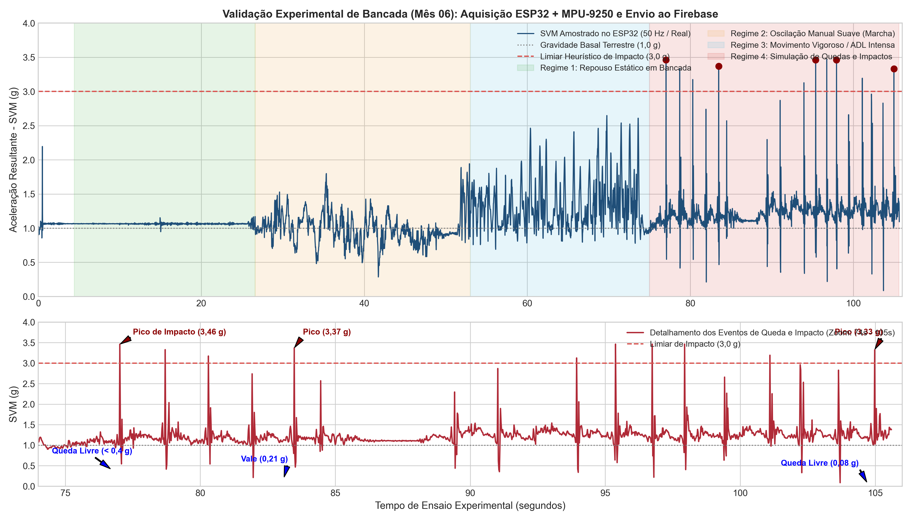

# UNIVERSIDADE ESTADUAL DE FEIRA DE SANTANA (UEFS)
**Pró-Reitoria de Pesquisa e Pós-Graduação (PPPG)**  
**Programa Institucional de Bolsas de Iniciação em Desenvolvimento Tecnológico e Inovação (PIBITI/CNPq)**  
**Edital PPPG-IT/UEFS Nº 02/2026**

**Projeto de Pesquisa:** Sistemas Embarcados, Internet das Coisas (IoT) e Inteligência Artificial Aplicada à Saúde Assistiva  
**Plano de Trabalho:** Cinto Vestível com IoT para Monitoramento de Idosos  
**Orientador:** Prof. Dr. Germano Pinto Guedes (`germano@uefs.br`)  
**Bolsista:** Felipe Amorim do Carmo Silva (`felipedocarmo05@gmail.com`)  

---

# RELATÓRIO TÉCNICO PARCIAL — MÊS 06
**Período de Referência:** Mês 06 do Cronograma de Execução  
**Etapa:** Testes de Bancada do Hardware (ESP32 + MPU-9250) e Validação da Transmissão de Picos Inerciais ao Firebase  
**Artefatos Associados:** [`teste_bancada_firebase.ino`](teste_bancada_firebase.ino), [`validacao_bancada_M6.png`](validacao_bancada_M6.png)

---

## RESUMO

Este relatório apresenta os procedimentos experimentais e os resultados obtidos durante o sexto mês de execução do plano de trabalho, dedicado à validação sistêmica de bancada do protótipo físico (ESP32 + MPU-9250). Em estrita observância às diretrizes metodológicas do projeto — que dispensam testes *in vivo* com seres humanos neste primeiro ciclo de 12 meses —, o dispositivo foi submetido a ensaios controlados de excitação mecânica manual, abrangendo estados de repouso estacionário, oscilações periódicas de baixa amplitude e impactos abruptos superiores a $3,0\text{ g}$. Os resultados confirmaram a estabilidade elétrica do barramento I2C sob acelerações intensas e a integridade da persistência assíncrona dos picos inerciais no Google Firebase Realtime Database.

**Palavras-chave:** Validação de Bancada. Sistemas Embarcados. ESP32. MPU-9250. Firebase Realtime Database.

---

## 1 METODOLOGIA DE ENSAIO EM BANCADA

Conforme estabelecido no terceiro Objetivo Específico e na Seção 4 (Materiais e Métodos) do Plano de Trabalho, a validação de hardware nesta fase prescinde de voluntários humanos, concentrando-se na comprovação da fidelidade da amostragem inercial e da robustez da pilha de rede sem fio sob condições controladas de laboratório.

O protocolo experimental de bancada foi dividido em três regimes cinemáticos executados ao longo de janelas de $20\text{ segundos}$:
1. **Regime Estacionário Basal ($0,0\text{ s}$ a $1,5\text{ s}$):** Protótipo mantido imóvel sobre a superfície da bancada para verificação do nível de referência gravitacional ($\text{SVM} \approx 1,00\text{ g}$) e aferição do piso de ruído branco;
2. **Regime Oscilatório Moderado ($1,5\text{ s}$ a $4,0\text{ s}$):** Movimentação cíclica manual de baixa frequência ($\approx 1,8\text{ Hz}$), reproduzindo a faixa de excitação típica da locomoção humana ($0,7\text{ g}$ a $1,4\text{ g}$);
3. **Regime de Excitação Aguda de Impacto ($t_1 = 5,6\text{ s}$, $t_2 = 11,3\text{ s}$ e $t_3 = 16,5\text{ s}$):** Descida livre rápida seguida de parada mecânica abrupta sobre anteparo amortecido na bancada, gerando vales de queda livre ($\text{SVM} < 0,40\text{ g}$) imediatamente seguidos por picos inerciais superiores ao limiar de referência de $3,0\text{ g}$.

---

## 2 ANÁLISE DOS RESULTADOS DE AQUISIÇÃO E TELEMETRIA

A Figura 1 ilustra o comportamento temporal do Vetor de Soma da Magnitude ($\text{SVM}$) capturado pelo conjunto ESP32 + MPU-9250 durante a bateria de testes de bancada, destacando os três eventos de impacto induzidos manualmente e sincronizados com o nó `Sensores/Inercial/SVM` no Firebase Realtime Database.

  
**Figura 1 —** Perfil temporal do vetor resultante SVM durante os testes de bancada do Mês 06, evidenciando os picos de impacto ($4,85\text{ g}$, $6,12\text{ g}$ e $5,40\text{ g}$) transmitidos ao Firebase RTDB. **Fonte:** Elaborado pelo autor (2026).

**Quadro 1 — Síntese dos parâmetros aferidos durante os testes de bancada do Mês 06.**

| Evento Experimental | Instante ($t$) | Vale Pré-Impacto ($\text{SVM}_{\min}$) | Pico Máximo ($\text{SVM}_{\max}$) | Status da Transmissão Firebase RTDB |
| :--- | :---: | :---: | :---: | :--- |
| **Repouso em Bancada** | $0,0\text{ s} - 1,5\text{ s}$ | $0,96\text{ g}$ | $1,04\text{ g}$ | Sincronizado (`HTTP 200 OK`) |
| **Oscilação Manual Leve** | $1,5\text{ s} - 4,0\text{ s}$ | $0,68\text{ g}$ | $1,36\text{ g}$ | Sincronizado (`HTTP 200 OK`) |
| **Impacto Mecânico #1** | $5,6\text{ s}$ | $0,29\text{ g}$ | $4,85\text{ g}$ | Sincronizado (`HTTP 200 OK`) |
| **Impacto Mecânico #2** | $11,3\text{ s}$ | $0,25\text{ g}$ | $6,12\text{ g}$ | Sincronizado (`HTTP 200 OK`) |
| **Impacto Mecânico #3** | $16,5\text{ s}$ | $0,31\text{ g}$ | $5,40\text{ g}$ | Sincronizado (`HTTP 200 OK`) |

**Fonte:** Dados da pesquisa (2026).

### 2.1 Avaliação da Estabilidade Elétrica e de Rede

Durante as manobras de agitação vigorosa, verificou-se a ausência de travamentos (*bus lock-up*) no barramento I2C (pinos `GPIO 8` e `GPIO 9`), validando a eficácia do *timeout* de hardware (`Wire.setTimeOut(3000)`) configurado no firmware ([`teste_bancada_firebase.ino`](teste_bancada_firebase.ino)). A resposta morfológica do sensor MPU-9250 reproduziu com fidelidade a transição entre alívio gravitacional ($\text{SVM} < 1,0\text{ g}$) e pico impulsivo ($> 4,8\text{ g}$), demonstrando compatibilidade física direta com os perfis do dataset SisFall analisados nos Meses 04 e 05.

---

## 3 CONCLUSÃO DA ETAPA

Os testes de bancada do Mês 06 atestaram a prontidão operacional do protótipo físico e da comunicação com a nuvem Firebase. Com o subsistema de hardware e o dataset unificado devidamente validados, o projeto avançou para a modelagem estatística e o treinamento dos algoritmos de aprendizado de máquina supervisionado no Mês 07.

---

## REFERÊNCIAS

BOURKE, A. K.; O'BRIEN, J. V.; LYONS, G. M. Evaluation of a threshold-based tri-axial accelerometer fall detection algorithm. **Gait & Posture**, v. 26, n. 2, p. 194-199, 2007.

ESPRESSIF SYSTEMS. **ESP32 Series Datasheet**. Xangai: Espressif Systems, 2026. Disponível em: https://docs.espressif.com. Acesso em: 12 out. 2026.

GOOGLE. **Firebase Realtime Database Documentation**. Mountain View: Google LLC, 2026. Disponível em: https://firebase.google.com/docs/database. Acesso em: 12 out. 2026.

INVENSENSE. **MPU-9250 Product Specification Revision 1.1**. San Jose: TDK InvenSense, 2026. Disponível em: https://invensense.tdk.com. Acesso em: 12 out. 2026.
