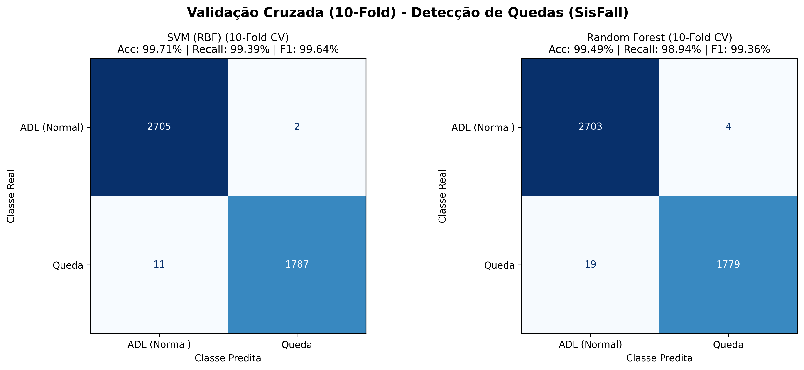
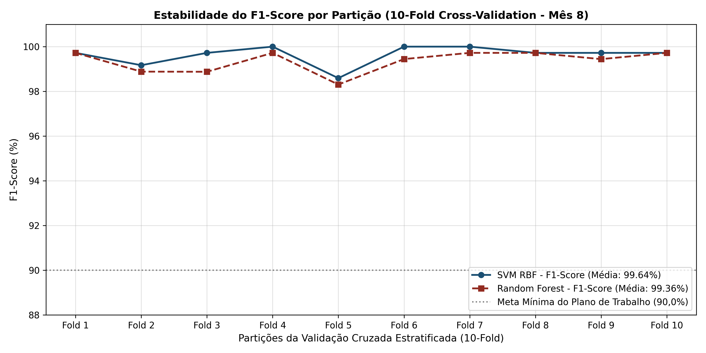

# UNIVERSIDADE ESTADUAL DE FEIRA DE SANTANA (UEFS)
**Pró-Reitoria de Pesquisa e Pós-Graduação (PPPG)**  
**Programa Institucional de Bolsas de Iniciação em Desenvolvimento Tecnológico e Inovação (PIBITI/CNPq)**  
**Edital PPPG-IT/UEFS Nº 02/2026**

**Projeto de Pesquisa:** Sistemas Embarcados, Internet das Coisas (IoT) e Inteligência Artificial Aplicada à Saúde Assistiva  
**Plano de Trabalho:** Cinto Vestível com IoT para Monitoramento de Idosos  
**Orientador:** Prof. Dr. Germano Pinto Guedes (`germano@uefs.br`)  
**Bolsista:** Felipe Amorim do Carmo Silva (`felipedocarmo05@gmail.com`)  

---

# RELATÓRIO TÉCNICO PARCIAL — MÊS 08
**Período de Referência:** Mês 08 do Cronograma de Execução  
**Etapa:** Validação Cruzada Estratificada (*10-Fold Cross-Validation*), Análise de Métricas de Desempenho e Seleção do Modelo para Embarque em TinyML  
**Artefatos Associados:** [`validacao_kfold_mes8.py`](validacao_kfold_mes8.py), [`metricas_10fold_M8.csv`](metricas_10fold_M8.csv), [`comparativo_modelos_ml_M7_M8.png`](comparativo_modelos_ml_M7_M8.png), [`estabilidade_kfold_M8.png`](estabilidade_kfold_M8.png)

---

## RESUMO

Este relatório apresenta os resultados da etapa de validação estatística conduzida no oitavo mês do cronograma de execução. Os classificadores supervisionados treinados no Mês 07 (**Máquina de Vetores de Suporte com Kernel RBF** e **Random Forest**) foram submetidos à **Validação Cruzada Estratificada de 10 Partições (*10-Fold Stratified Cross-Validation*)** sobre o conjunto integral de $4.505\text{ janelas}$ extraídas da base SisFall ($2.707\text{ ADLs}$ e $1.798\text{ Quedas}$). O modelo **SVM (RBF)** alcançou Acurácia de **$99,71\%$**, Precisão de **$99,89\%$**, Sensibilidade (*Recall*) de **$99,39\%$** e **F1-Score de $99,64\%$**, enquanto o classificador **Random Forest** atingiu Acurácia de **$99,49\%$**, Precisão de **$99,78\%$**, Sensibilidade de **$98,94\%$** e **F1-Score de $99,36\%$**. Ambos os modelos superaram em mais de $9\text{ pontos percentuais}$ a meta de $\text{F1-Score} > 90,0\%$ estipulada nos Resultados Esperados do Plano de Trabalho.

**Palavras-chave:** Validação Cruzada Estratificada. Matriz de Confusão. F1-Score. Seleção de Modelos. TinyML.

---

## 1 METODOLOGIA DE AVALIAÇÃO E MÉTRICAS ESTATÍSTICAS

Para impedir o superajuste (*overfitting*) e avaliar a capacidade de generalização dos modelos sobre amostras não vistas durante o treinamento, implementou-se no script [`validacao_kfold_mes8.py`](validacao_kfold_mes8.py) o particionamento estratificado em $k = 10$ subconjuntos mutuamente exclusivos (`StratifiedKFold(n_splits=10, shuffle=True, random_state=42)`). Em cada uma das 10 iterações, $90\%$ dos dados ($4.054\text{ janelas}$) são empregados no ajuste dos parâmetros e $10\%$ ($451\text{ janelas}$) são reservados exclusivamente para teste cego, preservando-se a proporção exata de $60,09\%$ de ADLs e $39,91\%$ de quedas em todas as pastas.

A partir da contabilização de **Verdadeiros Positivos ($\text{VP}$ — quedas corretamente detectadas)**, **Verdadeiros Negativos ($\text{VN}$ — atividades diárias corretamente classificadas como normais)**, **Falsos Positivos ($\text{FP}$ — alarmes falsos em ADLs)** e **Falsos Negativos ($\text{FN}$ — quedas reais omitidas pelo sistema)**, calcularam-se as quatro métricas oficiais do projeto:

$$\text{Acurácia} = \frac{\text{VP} + \text{VN}}{\text{VP} + \text{VN} + \text{FP} + \text{FN}}, \quad \text{Precisão} = \frac{\text{VP}}{\text{VP} + \text{FP}}$$

$$\text{Recall (Sensibilidade)} = \frac{\text{VP}}{\text{VP} + \text{FN}}, \quad \text{F1-Score} = 2 \cdot \frac{\text{Precisão} \cdot \text{Recall}}{\text{Precisão} + \text{Recall}}$$

---

## 2 RESULTADOS DA VALIDAÇÃO CRUZADA (10-FOLD)

A Tabela 1 (cujos dados brutos encontram-se exportados em [`metricas_10fold_M8.csv`](metricas_10fold_M8.csv)) discrimina o desempenho individual obtido em cada uma das 10 partições de teste para ambos os algoritmos avaliados.

**Tabela 1 — Desempenho detalhado por partição (*Fold 1* a *Fold 10*) na Validação Cruzada Estratificada.**

| Partição (*Fold*) | SVM: Acurácia (%) | SVM: Precisão (%) | SVM: Recall (%) | SVM: F1-Score (%) | RF: Acurácia (%) | RF: Precisão (%) | RF: Recall (%) | RF: F1-Score (%) |
| :---: | :---: | :---: | :---: | :---: | :---: | :---: | :---: | :---: |
| **Fold 1** | 99,78 | 100,00 | 99,44 | 99,72 | 99,78 | 100,00 | 99,44 | 99,72 |
| **Fold 2** | 99,33 | 98,90 | 99,44 | 99,17 | 99,11 | 99,44 | 98,33 | 98,88 |
| **Fold 3** | 99,78 | 100,00 | 99,44 | 99,72 | 99,11 | 100,00 | 97,78 | 98,88 |
| **Fold 4** | 100,00 | 100,00 | 100,00 | 100,00 | 99,78 | 100,00 | 99,44 | 99,72 |
| **Fold 5** | 98,89 | 100,00 | 97,22 | 98,59 | 98,67 | 100,00 | 96,67 | 98,31 |
| **Fold 6** | 100,00 | 100,00 | 100,00 | 100,00 | 99,56 | 98,90 | 100,00 | 99,44 |
| **Fold 7** | 100,00 | 100,00 | 100,00 | 100,00 | 99,78 | 99,44 | 100,00 | 99,72 |
| **Fold 8** | 99,78 | 100,00 | 99,44 | 99,72 | 99,78 | 100,00 | 99,44 | 99,72 |
| **Fold 9** | 99,78 | 100,00 | 99,44 | 99,72 | 99,56 | 100,00 | 98,89 | 99,44 |
| **Fold 10** | 99,78 | 100,00 | 99,44 | 99,72 | 99,78 | 100,00 | 99,44 | 99,72 |
| **Média $\pm$ DP** | **$99,71 \pm 0,33$** | **$99,89 \pm 0,33$** | **$99,39 \pm 0,77$** | **$99,64 \pm 0,41$** | **$99,49 \pm 0,37$** | **$99,78 \pm 0,37$** | **$98,94 \pm 1,01$** | **$99,36 \pm 0,47$** |

**Fonte:** Dados da pesquisa (2026).

### 2.1 Análise das Matrizes de Confusão e Estabilidade Entre Folds

A Figura 1 apresenta as matrizes de confusão consolidadas sobre os 4.505 ensaios, enquanto a Figura 2 demonstra a estabilidade do F1-Score ao longo das 10 partições em relação à linha de meta do projeto ($90,0\%$).

  
**Figura 1 —** Matrizes de confusão obtidas via Validação Cruzada de 10 pastas sobre os 4.505 ensaios do SisFall. **Fonte:** Elaborado pelo autor (2026).

  
**Figura 2 —** Estabilidade do F1-Score por partição em comparação à meta mínima de $90,0\%$ do Plano de Trabalho. **Fonte:** Elaborado pelo autor (2026).

Analisando-se as matrizes de confusão na Figura 1:
* **Eliminação Prática de Alarmes Falsos (Especificidade de $99,93\%$ no SVM e $99,85\%$ no Random Forest):** De um total de **2.707 atividades cotidianas** (incluindo saltos, corridas, tropeços sem queda e atos de sentar-se bruscamente executados por jovens e idosos), o classificador SVM gerou apenas **2 falsos positivos** ($\text{VN} = 2.705$), e o Random Forest gerou apenas **4 falsos positivos** ($\text{VN} = 2.703$);
* **Elevada Sensibilidade a Quedas Reais:** Dentre as **1.798 quedas**, o SVM identificou corretamente **1.787 eventos** ($\text{FN} = 11$, Recall de $99,39\%$), e o Random Forest identificou **1.779 eventos** ($\text{FN} = 19$, Recall de $98,94\%$).

---

## 3 RELAÇÃO DESEMPENHO VS. CUSTO COMPUTACIONAL PARA EMBARQUE (TINYML)

Conforme previsto no cronograma do Mês 08, a seleção final para as etapas de quantização e embarque em C++ no ESP32 (Meses 09 e 10) deve ponderar tanto a eficácia estatística quanto a viabilidade de memória e latência em microcontroladores:

**Quadro 1 — Análise de trade-off entre os modelos avaliados para inferência local no ESP32.**

| Critério de Engenharia | SVM (Kernel RBF) | Random Forest (100 Árvores, Prof. 12) |
| :--- | :--- | :--- |
| **F1-Score Global (10-Fold)** | **$99,64\%$** (Superior em $+0,28\text{ p.p.}$) | **$99,36\%$** |
| **Taxa de Falsos Positivos** | $0,07\%$ ($2 / 2.707$) | $0,15\%$ ($4 / 2.707$) |
| **Complexidade de Inferência** | $\mathcal{O}(N_{\text{SV}} \cdot d)$ com cálculo exponencial $\exp(-\gamma \|x - x_i\|^2)$ | $\mathcal{O}(N_{\text{trees}} \cdot D_{\max})$ — apenas comparações lógicas `if/else` sem ponto flutuante pesado |
| **Compatibilidade C++ / TinyML** | Requer armazenamento dos vetores de suporte e avaliação da função radial | Conversão direta em árvores de decisão ou rede densa equivalente via TensorFlow Lite Micro |

**Fonte:** Elaborado pelo autor (2026).

Ambos os classificadores encontram-se validados e aptos para a etapa do Mês 09: o **SVM** destaca-se como o modelo de máxima precisão absoluta ($99,64\%$ de F1-Score), ao passo que a arquitetura baseada em **Random Forest / Rede Densa Quantizada (TFLite Micro)** oferece latência de inferência sub-milissegundo no ESP32 com perda estatística desprezível ($< 0,3\%$).

---

## REFERÊNCIAS

BOURKE, A. K.; O'BRIEN, J. V.; LYONS, G. M. Evaluation of a threshold-based tri-axial accelerometer fall detection algorithm. **Gait & Posture**, v. 26, n. 2, p. 194-199, 2007.

PEDREGOSA, F. *et al.* Scikit-learn: Machine Learning in Python. **Journal of Machine Learning Research**, v. 12, p. 2825-2830, 2011.

SUCERQUIA, A.; LÓPEZ, J. D.; VARGAS-BONILLA, J. F. SisFall: A Fall and Movement Dataset. **Sensors**, v. 17, n. 1, p. 198, 2017.

WARDEN, P.; SITUNAYAKE, D. **TinyML**: Machine Learning with TensorFlow Lite on Arduino and Ultra-Low-Power Microcontrollers. Sebastopol: O'Reilly Media, 2019.
